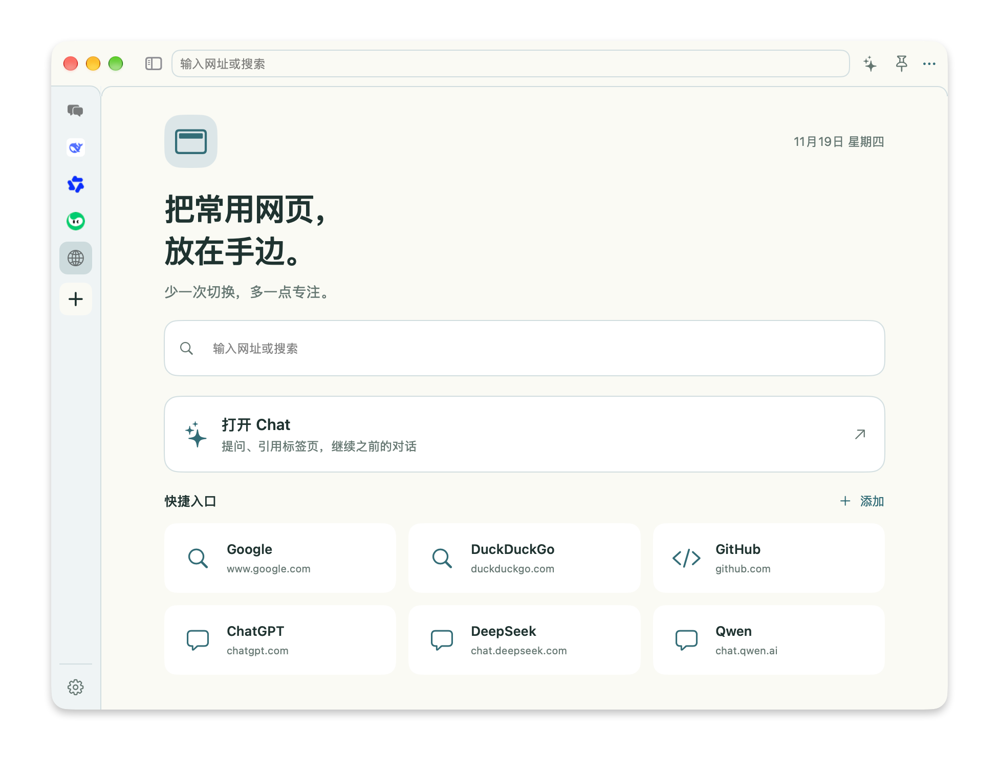

<p align="center">
  
</p>

# Perch

[](https://github.com/ShawnKung/Perch/actions/workflows/ci.yml)
[](https://github.com/ShawnKung/Perch/releases)
[](LICENSE)

Perch 是一款原生 macOS 菜单栏浏览器，让常用网页和 AI 对话随手可及。



## 功能

- 菜单栏快捷打开，支持多标签、书签、浏览历史和快捷键。
- 标签支持彩色分组、命名与折叠。右键标签创建或加入分组，右键组标题编辑；可拖入、拖出或整体移动分组，窄栏保留颜色和折叠入口。
- 折叠当前页面所在分组时，当前标签临时显示在组标题下方，切走后隐藏，仍保留原来的分组归属。
- 分组自动显示在「书签与历史 → 标签组」中，每组是一个目录。右键「隐藏分组」移除打开的标签并保留目录，可在管理页重新打开；「删除分组」删除目录及组内标签，「解散分组」保留标签并移除分组。
- 使用 Command 加号或减号缩放网页时，可在收藏按钮下方查看比例、调整或重置。
- 切换标签保留地址栏与首页搜索框的草稿、焦点和文字选区。
- 新标签页提交网址或搜索后，可后退回到首页并恢复两处输入；首页书签在当前标签打开，从分组内打开的新标签继承来源分组。
- 关闭当前标签优先返回最近使用的标签。新建、关闭和分组折叠使用连续擦除动画，加号随列表移动；连续新建复用空白首页布局，保留有草稿或阅读位置的页面。
- 从其他浏览器导入数据，支持密码保存和网页链接预览；Option 临时预览可在 Perch 中打开，⌘点击或中键点击链接在后台新建标签。
- 在「设置 → 导入导出」勾选设置与布局、AI 配置、书签与标签组并导出 ZIP；可选包含模型与搜索密钥（默认关闭，ZIP 为明文）。导入确认后只替换备份包含的类别，标签组导入为隐藏目录，已有打开页面保留；不包含密码、Cookie、浏览历史或聊天记录。
- 接入兼容 OpenAI 或 Anthropic 协议的模型，支持网页引用、附件、联网搜索和对话历史。
- AI 回车发送或加入队列后立即清空输入框；发送未受理时保留草稿。
- 每个 Chat 记住最后选择的模型，切换后立即保存，重启仍保留；点击加号可返回尚未发送的草稿，恢复文字、附件与引用，发送后下次加号开始新对话。
- Chat 支持后台执行：切换对话或关闭展示标签后继续生成，历史名称右侧显示运行转圈；空闲时悬停显示归档按钮。
- 右键会话可重命名、置顶或取消置顶；「置顶会话」位于 Chat 上方，取消置顶后回到原分组。
- 在「设置 → 常规 → 窗口」开启「主窗口跟随鼠标显示」，每次唤出时在鼠标附近打开。
- 在对话中查看 Markdown、表格与图表，导出文本文件。
- 选中 Chat 回答后点击「引用到对话」，即可围绕片段追问；输入框展示引用，可随时移除。悬停回答或搜索列表中的来源链接可查看来源卡片，点击在 Perch 内打开。
- 在「设置 → 常规 → 外观」调整 Chat字号，标题、历史列表、思考过程和其他文字按比例调整。

## 安装

从 [Releases](https://github.com/ShawnKung/Perch/releases) 下载 Apple Silicon 应用，解压后将 `Perch.app` 移到「应用程序」文件夹。

发布包使用固定的自签名证书，未经 Apple 公证，首次打开可能需要在 macOS 设置中手动允许。

### 发布新版本

将准备发布的代码合入 `main` 后，为该提交推送 `v主版本.次版本.修订号` 格式的标签，例如 `git tag v0.1.2 && git push origin v0.1.2`。CI 从标签设置应用的显示版本号，构建和自检通过后自动创建 GitHub Release 并上传 Apple Silicon 包。标签必须使用三段数字，不能包含前导零或预发布后缀；其他标签不会发布。不要移动或重复使用已经发布的标签。

本地构建的版本和构建号以 `resources/Info.plist` 为准；发布构建的构建号以其中的整数为基数，加上 GitHub Actions 的递增运行编号。发布时 CI 只修改运行器上的副本，不改仓库文件。发布新功能或修复时仍应按工程规范更新该文件的版本和构建号。

也可以在 GitHub Actions 手动运行 CI，并在 `verify_release_tag` 中填入拟发布的标签，预演对应版本的构建和签名；预演不会创建标签或 Release。

也可以在 Mac 上从源码构建并安装：

```sh
git clone https://github.com/ShawnKung/Perch.git
cd Perch
make install
```

需要 macOS 13+、Xcode 或 Apple Command Line Tools，以及 Python 3。源码构建使用本机签名，请保留 `~/Library/Application Support/Perch Signing/` 以便后续更新继续访问钥匙串。

## 开发

```text
src/
  App/          应用入口、主界面、设置与管理页
  Browser/      标签、导航、书签、导入、密码与网页预览
  AI/           对话、历史、供应商协议与内容渲染
  Helpers/      独立编译和签名的钥匙串组件
tests/          隔离 Swift 自检与 Python 合成接口服务
scripts/        安装、签名、图标生成与优化工具
resources/      应用元数据（Info.plist）
assets/         图标原图、本地 Markdown 库与第三方许可
.github/        CI 与发布工作流
build.sh        编译、资源打包与签名的唯一入口
Makefile        常用开发命令
```

运行 `make test` 检查编译、签名和隔离数据自检，`make check` 运行完整回归，`make help` 查看专项检查和预览命令。GUI 回归需要可用的 macOS 桌面会话；检查只使用隔离配置和合成数据。

源码仍通过 `swiftc` 构建，无需 Xcode 工程或 Swift Package。新增 Swift 文件时更新 `build.sh` 中对应的编译列表；Swift 自检随主程序编译，钥匙串组件单独构建。更多协作约定见 [AGENTS.md](AGENTS.md)，贡献说明见 [CONTRIBUTING.md](CONTRIBUTING.md)。

## 隐私

书签、设置和浏览历史保存在本机；对话和附件保存在本机应用支持目录。网站密码和 AI 密钥保存在 macOS 钥匙串。使用 AI 功能时，发送的消息和主动选择的内容会传给所选模型供应商。

## 许可证

项目代码采用 [MIT 许可证](LICENSE)。第三方资源的许可和署名见 [assets](assets/) 及 [Markdown 资源说明](assets/markdown/ATTRIBUTION.md)。
